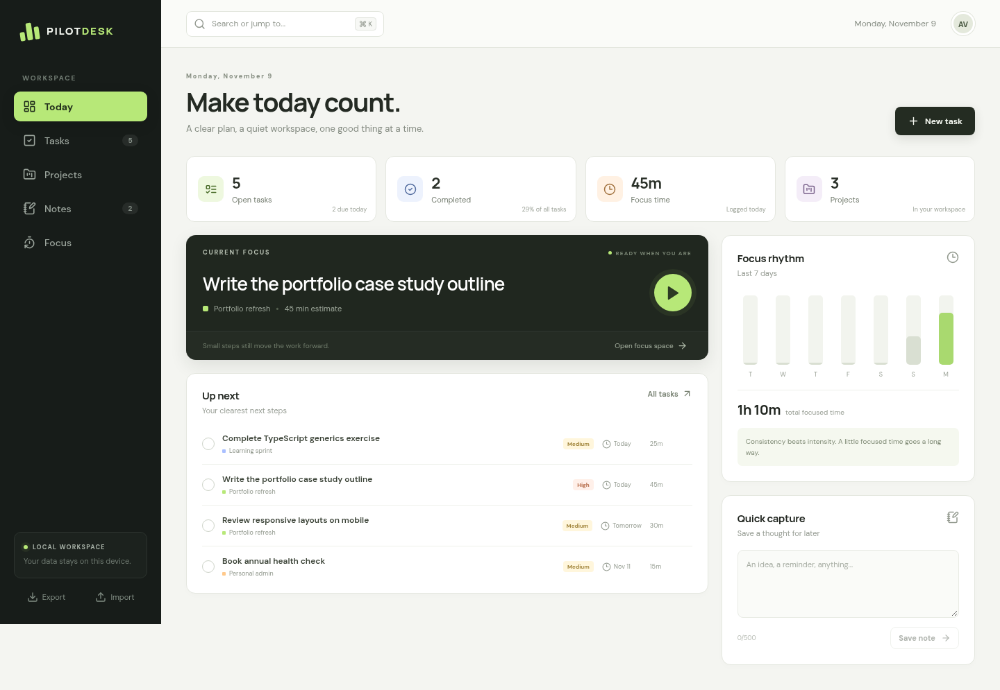

# PilotDesk

**Live demo:** [Open PilotDesk](https://akverma1210.github.io/pilotdesk/)

Try the hosted version without installing anything. It runs entirely in your browser and stores workspace data in that browser's localStorage. Clearing site data removes saved work, so export a JSON backup before switching browsers or devices. The optional Electron desktop shell is available from the source code.

A calm, local-first desktop workspace for tasks, projects, notes and focused work.

PilotDesk brings the shape of a desktop operating system to personal productivity: one shell, a small set of focused modules, fast keyboard navigation and data that stays on your device. It is an original React and TypeScript implementation, not a fork or a copy of another project's code or history.



## What you can do

- **Plan today:** see open work, due dates, completion progress, focus time and active projects at a glance.
- **Manage tasks:** add tasks with a project, due date, priority and time estimate; search, filter, change status, complete or delete them.
- **Grow projects:** create color-coded projects and track completion and the next actionable step.
- **Capture notes:** write, edit, pin and delete notes, or save a quick thought from the Today view.
- **Focus deliberately:** choose a task, run a 15, 25 or 45 minute timer, pause or reset it, and keep a session history.
- **Move quickly:** press `Ctrl+K` or `Cmd+K` to open the command palette.
- **Keep your data:** everything is stored locally. Export and restore a JSON backup at any time.

The first launch includes clearly ordinary sample tasks, projects and notes so the interface is easy to explore. New items are saved in your browser or desktop profile immediately.

## Stack

| Layer | Technology |
| --- | --- |
| UI | React 19, TypeScript, Vite |
| Icons | Lucide React |
| Desktop shell | Electron with an isolated, sandboxed renderer |
| Persistence | Browser `localStorage` with JSON export/import |
| Unit and UI tests | Vitest, Testing Library |
| Browser tests | Playwright |

There is no server, account, tracking, API key or cloud database. The app works without environment variables.

## Quick start

Requirements: Node.js 20 or newer and npm.

```bash
npm install
npm run dev
```

Open the local URL printed by Vite. To create a production build:

```bash
npm run build
npm run preview
```

## Run as a desktop app

Install the [Electron prerequisites](https://www.electronjs.org/docs/latest/development/build-instructions-linux) for your operating system if needed, then run:

```bash
npm run desktop
```

This creates a production build and opens PilotDesk in an Electron window. For desktop development, start Vite in one terminal and run this in another:

```bash
VITE_DEV_SERVER_URL=http://localhost:5173 npx electron .
```

The renderer has no Node integration. Electron's preload exposes only the app version and platform.

## Verify the project

```bash
npm test           # reducer, selector, persistence and UI workflow tests
npm run build      # strict TypeScript check and production build
npm run test:e2e   # real Chromium workflow and mobile viewport tests
```

Playwright needs a Chromium installation. Run `npx playwright install chromium`, or set `CHROME_PATH` to an existing Chrome/Chromium executable. The test server starts automatically.

To regenerate the interface previews in `docs/`:

```bash
npm run capture
```

## Project structure

```text
electron/             Desktop window and isolated preload
src/
  components/         Dialogs, command palette and task rows
  lib/                Domain types, reducer, persistence and selectors
  views/              Today, Tasks, Projects, Notes and Focus modules
  App.tsx             Workspace shell and navigation
  styles.css          Responsive visual system
e2e/                  Real-browser workflow tests
scripts/              Screenshot capture utility
docs/                 Interface previews
```

## Data and backups

PilotDesk stores its workspace under `pilotdesk.workspace.v1` in the current browser or Electron profile. Export downloads a readable JSON backup. Import validates the backup's main collections before replacing the current workspace. Export first if you want to preserve the existing data.

Clearing site data or removing the desktop profile removes locally saved work, so periodic exports are recommended.

## Design principles

1. The next action should be obvious.
2. Local-first should be the default, not an afterthought.
3. Small modules are easier to understand and extend.
4. Motion and color should support attention, not compete for it.

## Copyright, attribution and license

**Original author:** [Anand Kishor Verma](https://github.com/akverma1210)  
**Original repository:** [akverma1210/pilotdesk](https://github.com/akverma1210/pilotdesk)

Copyright (c) 2026 Anand Kishor Verma. This project is available under the [MIT License](LICENSE).

The MIT License permits copying, modification and redistribution, and requires the copyright and permission notices in `LICENSE` to be included in all copies or substantial portions of the software. Keep that file intact when reusing or sharing this project. Credit to the original author and a link back to this repository are appreciated, but the license does not require a public contributor credit and these notices cannot prevent copying.
